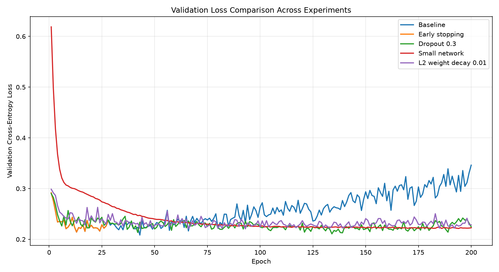
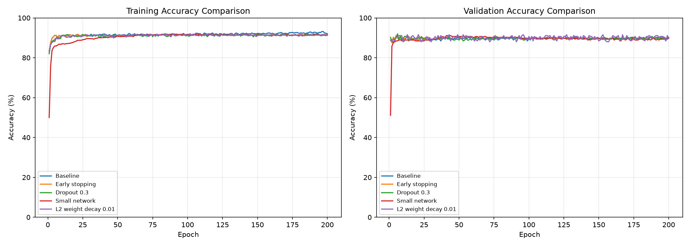

# Overfitting and Loss Curve Analysis with PyTorch

<p align="center">
  
  
  
  
</p>

## Overview

A practical deep learning project investigating overfitting, model generalization, and training dynamics using PyTorch. The project analyzes training and validation loss curves and compares multiple strategies for improving generalization.

Five model configurations are evaluated under the same dataset split: a baseline neural network, dropout regularization, early stopping, L2 weight decay, and a smaller network.

The goal is to understand how model complexity and regularization influence performance on unseen data.

## Objectives

- Understand the relationship between training and validation loss.
- Identify potential overfitting through learning curves.
- Compare regularization strategies under consistent experimental conditions.
- Select model checkpoints using validation loss.
- Evaluate the selected baseline model on a held-out test set.
- Generate reproducible experiment summaries, metrics, and visualizations.

## Tech Stack

| Technology | Purpose |
|---|---|
| Python | Core programming language |
| PyTorch | Neural network implementation and training |
| Scikit-learn | Dataset generation, preprocessing, and evaluation metrics |
| NumPy | Numerical operations |
| Pandas | Experiment history and result analysis |
| Matplotlib | Learning curves and performance visualizations |

## Dataset and Preprocessing

The dataset is generated using Scikit-learn's `make_moons` function with 1,500 samples and a noise level of `0.30`.

| Dataset split | Samples | Percentage |
|---|---:|---:|
| Training | 1,050 | 70% |
| Validation | 225 | 15% |
| Test | 225 | 15% |
| **Total** | **1,500** | **100%** |

Feature standardization uses `StandardScaler`, fitted exclusively on the training data. The fitted scaler is then applied to the validation and test sets to prevent data leakage.

## Model Architecture

The baseline model is a multilayer perceptron (MLP) with the following configuration:

- Input features: 2
- Hidden layers: 3
- Hidden units per layer: 128
- Hidden activation: ReLU
- Output classes: 2
- Loss function: Cross-entropy
- Optimizer: Adam
- Learning rate: `0.001`
- Maximum training duration: 200 epochs

The model checkpoint with the lowest validation loss is retained for evaluation.

## Experiments and Results

Five configurations were evaluated using the same data split.

| Experiment | Best Epoch | Best Validation Loss | Best Validation Accuracy |
|---|---:|---:|---:|
| Baseline | 43 | 0.2084 | 90.67% |
| Dropout (0.3) | 134 | 0.2108 | 90.67% |
| Early stopping | 13 | 0.2143 | 90.67% |
| L2 weight decay (0.01) | 93 | 0.2208 | 91.11% |
| Smaller network | 164 | 0.2214 | 89.33% |

### Interpretation

- **Baseline:** Achieved the lowest best validation loss among the five configurations.
- **Dropout:** Achieved a lower final validation loss than the baseline.
- **Early stopping:** Stopped training after 28 epochs instead of completing all 200 epochs.
- **L2 regularization:** Achieved the highest best validation accuracy at 91.11%.
- **Smaller network:** Reduced model capacity but did not achieve the best validation metrics.

These findings apply to the configurations tested in this experiment. They do not establish that one technique will consistently outperform the others on different datasets.

## Visualizations

### Validation Loss Comparison



This plot compares validation loss across the baseline and regularization experiments, helping illustrate differences in model convergence and generalization.

### Training and Validation Accuracy



This plot compares accuracy trends during training and validation.

## Held-Out Test Evaluation

The baseline checkpoint selected using validation loss was evaluated on the independent test split.

| Metric | Result |
|---|---:|
| Test samples | 225 |
| Test loss | 0.1933 |
| Test accuracy | 92.44% |
| Macro F1-score | 92.44% |
| Correct predictions | 208 |
| Incorrect predictions | 17 |

### Confusion Matrix

Rows represent actual classes, and columns represent predicted classes.

```text
[[106   7]
 [ 10 102]]
```

The model correctly classified 208 out of 225 test samples. These results represent performance on one held-out split and should not be interpreted as a guarantee of future performance.

## Project Structure

```text
overfitting-loss-curves/
├── outputs/
│   ├── *_history.csv
│   ├── *_best.pt
│   ├── experiment_comparison.csv
│   ├── validation_loss_comparison.png
│   └── accuracy_comparison.png
├── reports/
│   └── final_report.md
├── src/
│   ├── data.py
│   ├── model.py
│   ├── train.py
│   ├── evaluate.py
│   └── compare_results.py
├── .gitignore
├── requirements.txt
└── README.md
```

## Installation

### 1. Clone the repository

```powershell
git clone https://github.com/behra527/pytorch-overfitting-analysis.git
cd pytorch-overfitting-analysis
```

### 2. Create and activate a virtual environment

```powershell
python -m venv .venv
.\.venv\Scripts\Activate.ps1
```

### 3. Install dependencies

```powershell
python -m pip install --upgrade pip
pip install -r requirements.txt
```

## Usage

Run the following commands from the project root.

### Prepare and inspect the dataset

```powershell
python src/data.py
```

### Train the baseline model

```powershell
python -c "from src.train import run_experiment; run_experiment(epochs=200, hidden_size=128, num_hidden_layers=3, dropout_rate=0.0, weight_decay=0.0, patience=None, history_name='baseline_history.csv')"
```

### Run the training script

```powershell
python src/train.py
```

### Compare experiment results

```powershell
python src/compare_results.py
```

### Evaluate the baseline checkpoint

```powershell
python src/evaluate.py
```

Training and evaluation scripts save model checkpoints, training histories, comparison results, and plots in the `outputs/` directory.

**Note:** The experiment metrics shown above are from the recorded project results. Re-running the scripts may produce different values if the implementation, random seeds, dependencies, or data split differ.

## Key Findings

1. Training accuracy alone is insufficient for assessing generalization.
2. A rising validation loss while training loss continues to decrease can indicate overfitting.
3. Early stopping can reduce unnecessary training time.
4. Dropout and L2 regularization affect model behavior differently.
5. Model complexity and regularization should be evaluated empirically.
6. A held-out test set provides a more independent performance estimate than training metrics.

## Limitations

- The dataset is synthetic and relatively small.
- Results are based on a single fixed split.
- Hyperparameters were not exhaustively optimized.
- Findings may not generalize to real-world datasets.
- The baseline's test score does not establish that it is the best model among all possible configurations.


---

*Developed as a hands-on project to study neural network training behavior, overfitting, and practical regularization techniques using PyTorch.*
